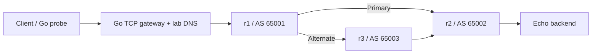

# Programmable Network Infrastructure & Diagnostics

A reproducible, CLI-driven Linux networking lab with an original Go TCP gateway,
real FRRouting BGP, controlled failures, and evidence-backed recovery reports.

[](https://github.com/ThePhysic/programmable-network-infrastructure/actions/workflows/validate.yml)

**Runtime:** Linux, root privileges, Python 3.10+, and Go 1.22+. Use a dedicated
Ubuntu VM or WSL2 lab. Reports and integrity checks also work on Windows.

**Start with the proof:** [curated results](docs/results.md) ·
[real incident report](examples/route-withdrawal/report.md) ·
[architecture](docs/architecture.md) · [reproduce a run](#quick-start-in-a-dedicated-ubuntu-linux-lab)

## What it demonstrates

- **Go networking:** concurrent bidirectional TCP forwarding, half-closes, bounded
  connections and buffers, backpressure, deadlines, cancellation, and shutdown.
- **Linux networking:** six namespaces, virtual Ethernet links, forwarding, DNS,
  firewall policy, traffic control, sockets, and packet captures.
- **Routing and resilience:** real BGP advertisements, withdrawals, inbound policy,
  alternate paths, and restoration of the preferred forwarding route.
- **Diagnostics:** faults tied to independent BGP, kernel, packet, and application
  observations, including uncertainty and contradictory evidence.
- **Operational verification:** byte-correct workloads, interrupted-run cleanup,
  resource measurements, and host-configuration checks.



Each node is a Linux network namespace. The gateway resolves `backend.lab`, accepts
concurrent client sessions, and forwards bytes through the routers. The CLI
establishes a healthy baseline, changes one condition, collects application and
network evidence, restores state, checks recovery, and tears down owned resources.

## Verified results at a glance

| Retained result | What was checked | Evidence |
|---|---|---|
| **24/24 fault experiments passed** | Three trials for each of eight scenarios; intended effect, restoration, cleanup | [Curated results](docs/results.md) |
| **5/5 lifecycle cases passed** | Collisions, interrupted startup, SIGTERM, permitted/forbidden flows, independent labs | [Lifecycle records](examples/evidence/lifecycle-summary.json) |
| **15,155/15,155 ordinary 64 KiB echoes were byte-correct** | Ordinary operations in a ten-round load run | [Load records](examples/evidence/soak-summary.json) |
| **261 controlled gateway rejections** | Expected overload against a 16-session budget; separate from ordinary echoes | [Load methodology](docs/validation.md#outcomes) |
| **104 historical Python tests, Go race tests, and vet passed** | Retained checks after hosted-run corrections | [Check log](examples/evidence/hosted-followup-checks.txt) |

The badge shows live CI status; [Actions](https://github.com/ThePhysic/programmable-network-infrastructure/actions/workflows/validate.yml)
provides individual runs. These datasets were recorded at documented earlier
source revisions; the load run declares a dirty working tree and retains source
hashes. See [provenance and environment](docs/validation.md#recorded-environment).
Published bundles are sanitized derivatives of those historical records; the
measured counts and quantiles are unchanged. [Export provenance](docs/privacy.md)
distinguishes their checksums from the original collected bytes.
The later local validation passed **161 Python tests with zero skips**, Go race
tests, vet, the build, and **8/8 fresh Linux/FRR integration scenarios**; see
[current local validation](docs/validation.md#public-export-verification).

## One incident: a withdrawn route breaks application traffic

The [recorded route-withdrawal experiment](examples/route-withdrawal/report.md)
follows the same client-to-gateway-to-backend path through three states:

| State | Independent observations | Byte-correct echo operations |
|---|---|---:|
| Baseline | Backend prefix present in BGP and the Linux forwarding table | 40/40 |
| Withdrawn | Prefix absent from both BGP and forwarding state; client operations fail | 0/8 |
| Restored | Routes return and correct traffic resumes; teardown verified separately | 40/40 |

Inspect the report's linked routing snapshots and gateway metrics, alongside the
[flushed packet captures](examples/route-withdrawal/final/captures/).
The injected fault is recorded as ground truth; the diagnosis cites observations
rather than selecting a cause from that label.

## Quick start in a dedicated Ubuntu Linux lab

Requires Linux with network namespaces, root privileges, Python 3.10+, and Go
1.22+. A dedicated Ubuntu 24.04 VM or WSL2 distribution is the reference runtime.
An ordinary container may lack the namespace/mount capabilities required by
`ip netns`; use a VM when those capabilities are unavailable.

```bash
sudo bash scripts/bootstrap-linux.sh
make build
sudo python3 -m netlab doctor
sudo python3 -m netlab run --scenario route-withdrawal --output results/route-demo
cat results/route-demo/report.md
python3 -m netlab verify results/route-demo
```

The output directory must be new. Dependencies use Ubuntu/Debian packages;
the Python CLI and Go programs have no third-party runtime libraries. The bootstrap
script installs compilers and network tools and adds root to FRRouting's `frrvty`
group. It is intended for the dedicated lab, not a production machine.

## Windows / WSL2

Create a dedicated distribution named `PNID-Lab` from an official Ubuntu rootfs.
Download the Ubuntu 24.04 amd64 WSL image and its checksum list from
[Ubuntu cloud images](https://cloud-images.ubuntu.com/wsl/releases/noble/current/),
verify the image SHA256, then import it into a new directory:

```powershell
wsl --import PNID-Lab "$env:USERPROFILE\pnid-lab-runtime\distro" <verified-rootfs.tar.gz> --version 2
.\scripts\wsl-lab.ps1 -Action Bootstrap
.\scripts\wsl-lab.ps1 -Action Build
.\scripts\wsl-lab.ps1 -Action Test
.\scripts\wsl-lab.ps1 -Action Doctor
.\scripts\wsl-lab.ps1 -Action Run -Scenario firewall-drop -Output results/firewall-demo
```

Run the helper from PowerShell in the checkout; it uses that checkout as the Linux
working directory. `-Distro` selects another explicitly designated lab distribution.
`Status` and `Down` inspect and stop the owned lab. The helper does not remove or
reconfigure existing WSL distributions. Root-owned generated files may require
Linux permissions when using a native Linux filesystem rather than a Windows mount.

## CLI

Global options precede the command. The default private runtime root is
`/var/tmp/pnid-<uid>`; the default binary is `bin/netlab-agent` in the checkout.

```bash
sudo python3 -m netlab --root /var/tmp/my-pnid up
sudo python3 -m netlab --root /var/tmp/my-pnid status
sudo python3 -m netlab --root /var/tmp/my-pnid down

sudo python3 -m netlab run --scenario dns-failure --duration 3 --rate 30 \
  --concurrency 4 --payload 4096 --output results/dns-demo

sudo python3 -m netlab suite --trials 3 --output results/repeated-suite
python3 scripts/summarize.py results/repeated-suite
python3 -m netlab report results/dns-demo/experiment.json
```

`run` and `suite` own startup and cleanup and refuse to take over an active lab.
Use `down` before running experiments if you previously used `up`. A command lock
prevents simultaneous CLI operations on the same runtime. Different private roots
produce different namespace names and can run independently.

| Scenario | Changed condition | Independent evidence |
|---|---|---|
| `route-withdrawal` | r2 withdraws the backend subnet | BGP prefix and forwarding route loss; failed echoes |
| `route-policy` | r1 rejects the backend prefix on both neighbors | Policy, BGP and route snapshots; failed echoes |
| `firewall-drop` | Backend firewall silently drops service TCP | Increased drop counter with route still present |
| `dns-failure` | Lab resolver returns NXDOMAIN | Actual DNS control query; gateway/client failure |
| `backend-down` | Echo listener stops | Absent listener with route still present |
| `link-loss` | Preferred r1–r2 link goes down | Changed next hop and successful alternate-path traffic |
| `packet-loss` | Gateway uplink gets delay, jitter, and loss | `tc` state/counters and measured application effects |
| `gateway-overload` | More held sessions than gateway capacity | Rejection counter increase and failed client operations |

The overload phase deliberately uses at least 48 clients, an unpaced workload, and
250 ms held connections against a 16-session gateway. Its effective workload is
recorded separately from baseline/recovery. Fault phase probes begin after fault
application and routing readiness checks; failover snapshots therefore establish
alternate-path operation, not zero-loss behavior during the transition.

## What an experiment retains

- `experiment.json`: topology, source hashes, environment, workload, phase results,
  injected change, interpreted evidence, recovery checks, and cleanup status.
- `report.md`: portable explanation with links to raw observations and limitations.
- `events.json`: ordered lifecycle events with wall timestamps and local monotonic durations.
- `baseline/`, `fault/`, `recovery/`: byte-verified probes; addresses, routes, BGP,
  sockets, DNS, firewall, link and traffic-control state; gateway metrics and logs.
- `final/captures/`: flushed packet traces from the gateway, r1, and backend.
- `manifest.json`: SHA256 and size for each retained artifact.

Open the report alongside its artifact directories. Verification detects changed,
missing, or additional files; hashes establish integrity relative to the retained
manifest, not authenticity against a malicious replacement of the entire bundle.
Reports can be regenerated on Windows without Linux privileges.

The report derives explanations from observations rather than the injected fault
label. A timeout remains ambiguous without discriminating evidence. Recovery
requires byte-correct traffic and independently restored state; teardown is checked
separately. Missing evidence is reported as unknown.

## Go software

`netlab-agent gateway` forwards streams with bounded concurrent sessions and fixed
buffers, per-direction idle deadlines, explicit upstream dial timeouts, correct
half-close behavior, and a bounded shutdown drain. Streams are never replayed.
The backend and probe also bound connections, memory, and retained samples.

The gateway exposes JSON metrics on `/metrics`, upstream-aware readiness on
`/health`, and process liveness on `/live`. The lab binds its metrics listener to
loopback inside the gateway namespace. Metrics include bytes, accepted/rejected
connections, active sessions, error classes, goroutines, memory, and descriptors.
Session logs preserve connection outcomes, upstream connection latency, and
experiment/flow identities. Linux CPU metrics report cumulative process user and
system seconds; compare snapshots to calculate CPU consumed over a window.
Logging uses a bounded queue and a separate sink worker. `log_dropped_total` and
write-error metrics disclose incomplete session logs when the sink cannot keep up.
Shutdown stops waiting at its deadline; an arbitrary blocked writer can retain one
sink goroutine until that writer returns or the process exits. Session workers and
their connection limits remain independent of the sink.

```bash
bin/netlab-agent gateway --help
bin/netlab-agent backend --help
bin/netlab-agent probe --help
```

## Validation and measurement

```bash
make test                     # Go race tests, vet, Python unit/negative tests
sudo make integration         # All eight real namespace/FRR fault scenarios
sudo python3 scripts/integration.py --trials 3 --output results/acceptance
sudo python3 scripts/lifecycle.py --output results/lifecycle
sudo python3 scripts/soak.py --output results/soak
```

Acceptance requires observed scenario effects, successful recovery, verified
cleanup, and unchanged host routes/firewall/forwarding settings. Host comparisons
distinguish firewall configuration from naturally advancing packet/byte counters;
the raw before/after observations remain available. Unit tests also
exercise stream isolation, half-closes, overload, timeouts, cancellation, payload
corruption, ownership conflicts, interrupted experiments, and unsupported diagnoses.
The CI workflow runs the checks on an Ubuntu runner and uploads only the audited
sanitized `results/public-ci` tree, with seven-day retention. Export or privacy-gate
failure has no fallback to raw output. See the [public-evidence workflow](docs/privacy.md#future-runs-and-ci).

Measurements describe successful complete echo operations separately from failures.
Each operation opens a new TCP connection; this is not a persistent-stream bandwidth
benchmark. Percentiles use a bounded successful-operation reservoir; full aggregate
counts and sample truncation are disclosed. Recovery timings are sampled bounds
that include restoration and collection gaps. Routing convergence remains unmeasured
unless a dedicated, sourced measurement is added.

See [curated results](docs/results.md), [architecture](docs/architecture.md),
[interfaces and evidence contract](CONTRACT.md),
[measurement methodology](docs/measurement.md), [validation](docs/validation.md),
[engineering lessons](docs/review.md), and [evidence navigation](examples/README.md)
for deeper inspection.

## Isolation and limitations

Mutations target owned namespaces, virtual links, and processes. Ownership uses a
private mode-0700 runtime directory, recorded namespace identities, and process
identity checks. Network faults do not modify host routes, firewall rules, or
forwarding settings. Captures contain only the isolated synthetic workload and are
bounded by a ring. After an interruption, rerun `down` with the same `--root`.

Current public evidence uses neutral execution/host labels and opaque labels for
incidental host-side route addresses. These are synthetic metadata, not commands
or original addresses; lab routing and measurement fields retain their meaning.
**Original records remain in older public Git commits; forks, clones, caches,
and earlier CI downloads can retain copies.** This minimizes current and future publication; it does
not erase previous disclosure or promise anonymity. See the
[privacy scope and export provenance](docs/privacy.md).

This is an inspectable engineering lab with a fixed topology, not a production
network controller. It does not claim comprehensive automated root-cause analysis,
production service discovery, or a secure Internet-facing proxy. A web dashboard,
Kubernetes, IPv6, WireGuard, and eBPF remain optional extensions. Virtual-lab timing
depends on the stated VM/kernel/hardware and should not be generalized to physical
production networks.
