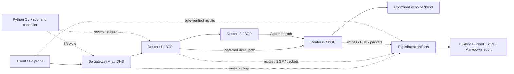

# Architecture and evidence semantics

The CLI coordinates an isolated Linux lab. Real TCP bytes flow through the
authored Go gateway; Linux forwarding tables and FRRouting BGP select the backend
path. Python uses the standard library for lifecycle, DNS, evidence collection,
and reporting. Go uses the standard library for concurrent networking and load.

Each of the six nodes has its own Linux network namespace. The only links are
owned virtual Ethernet pairs; the lab has no Internet gateway. Namespace identity
is derived from a private runtime directory and checked against ownership state.
Firewall and traffic-control mutations execute only inside owned namespaces.
The host's firewall, default routes, and forwarding configuration are outside the
controller's mutation scope. Cleanup must remove owned processes and namespaces
even after a partial startup; a stale PID file alone never authorizes killing a
host process.

## Component responsibilities

| Component | Responsibility | Evidence |
|---|---|---|
| CLI and experiment controller | Validate inputs; start topology; sequence baseline, change, and restoration; guarantee teardown | Events, workload, environment, cleanup record |
| Linux lab | Addresses, forwarding, BGP configuration, scoped firewall/netem state, process lifecycle | Raw command output, control-plane JSON, packet capture |
| Go gateway | Concurrent stream forwarding, bounded sessions, deadlines, cancellation, shutdown | Counters, error classes, readiness, structured logs |
| Controlled backend and probes | Return deterministic bytes; generate bounded traffic; check exact results | Per-operation samples and aggregate probe measurements |
| DNS responder | Resolve the controlled backend name; introduce explicit resolver failure | DNS query result and process logs |
| Reporter | Compare sourced observations and express uncertainty | Diagnosis support references, conflicts, restoration checks |

## Evidence contract

An experiment has stable experiment, phase, node, and flow identities. Every
phase retains its raw snapshot alongside normalized observations. The snapshot's
`evidence` map associates an observation with its source artifact; the phase's
`artifact_base` resolves those relative names inside the experiment directory.
The report links primary evidence. A manifest records artifact hashes so a reader
can inspect what the conclusions refer to. A report generator does not prove the
authenticity of arbitrary externally edited input; provenance depends on retaining
the original run and its manifest.

The injected fault is known experimental ground truth. It is recorded separately
from observations and never selects the diagnosis. A timeout alone cannot identify
filtering, missing routes, an absent service, or saturation. The reporter supports
mechanisms only when state or counter changes independently support them, marks
missing sources provisional, and lists conflicting signals. Multiple supported
mechanisms do not establish a unique root cause.

Routing-policy attribution additionally requires an observed backend-prefix deny
list attached inbound to both r1 neighbors. The normalized `backend_prefix_denied`
observation links FRRouting running configuration and prefix-list output; an
injected scenario name is insufficient. Baseline and restoration require the
backend-prefix denial to be absent, with primary evidence retained.

The link-loss demonstration needs both a changed selected next hop and successful
application traffic to support use of an alternate path. A BGP route alone cannot
prove application reachability. A failed DNS control query alongside successful
traffic is a discrepancy to explain, not proof of an application outage.

The DNS experiment can add a gateway-origin direct-IP control. Successful bytes
on that control show usable gateway-to-backend transport despite the failed name
lookup. It bypasses DNS and proxy forwarding, so it does not prove the client-to-
proxy hop or the gateway's stream forwarding is healthy. A failed direct-IP
control leaves additional transport causes possible.

## Recovery and measurement

Restoration requires successful baseline and recovery probes plus independently
observed healthy routes, BGP, listener, DNS, link, filter, and traffic-control state.
Additional observed selected-path state must match the baseline. Missing
evidence means unverified restoration; disabling an injector does not establish
recovery. Teardown verification is reported separately from service restoration.
Regenerating a report recomputes both diagnosis and scenario acceptance from the
current observations; persisted `result` flags and saved checks cannot establish
a successful run.

Probe results count all attempted operations and separate failures from
percentiles of successful complete byte-verified operations. Workload parameters,
measurement duration, sample count, environment, payload, and concurrency travel
with the report. Low sample counts and bounded per-operation sample retention are
disclosed. A single p99 comparison does not establish statistical significance.

Monotonic local durations support timing measurements; wall timestamps support
human correlation. Snapshot collection intervals cannot establish exact routing
convergence or zero-loss failover. The report only accepts explicitly defined,
artifact-linked timing measurements; otherwise detection, convergence, first
success, and stable recovery clocks remain unmeasured. Repeat trials under the
same conditions before drawing performance conclusions.

## Boundaries

This is a contained engineering testbed with a terminal interface and portable
artifacts. Real Linux privileges and namespace capabilities are required. The
gateway and lab are not production network controllers, an Internet proxy, or a
claim of autonomous diagnosis for arbitrary outages. A dashboard, Kubernetes,
secure overlays, IPv6, and eBPF can extend the core after its behavior is verified.
